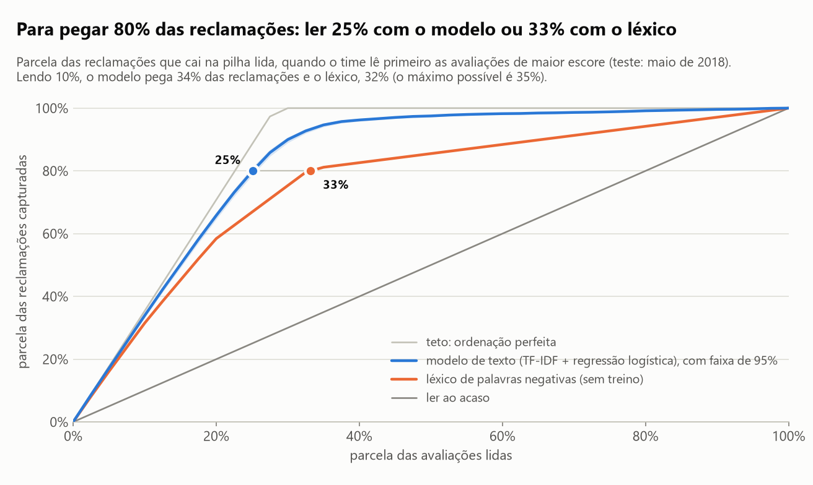
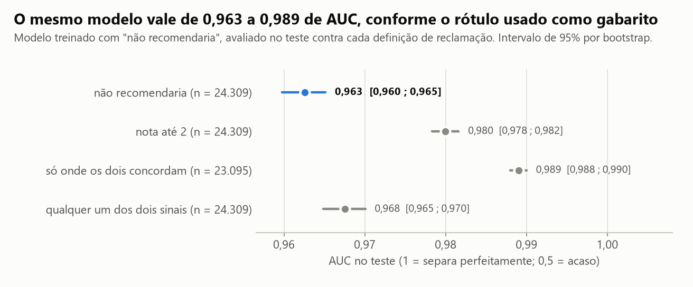
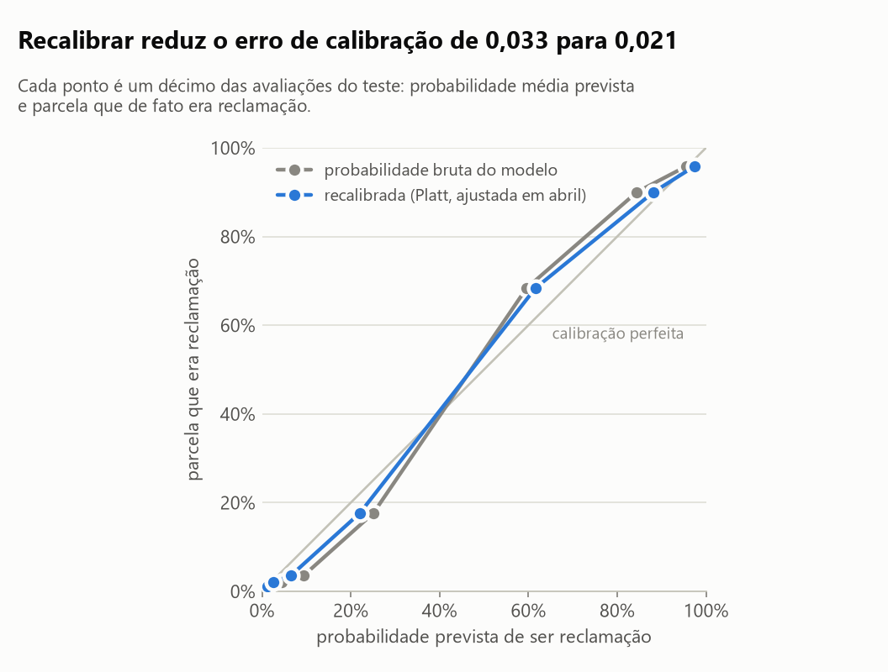
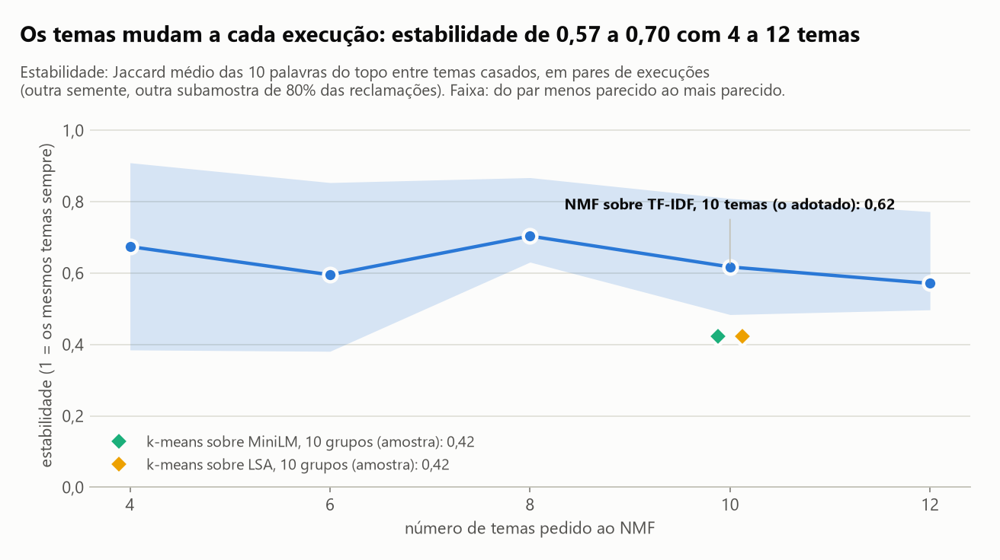
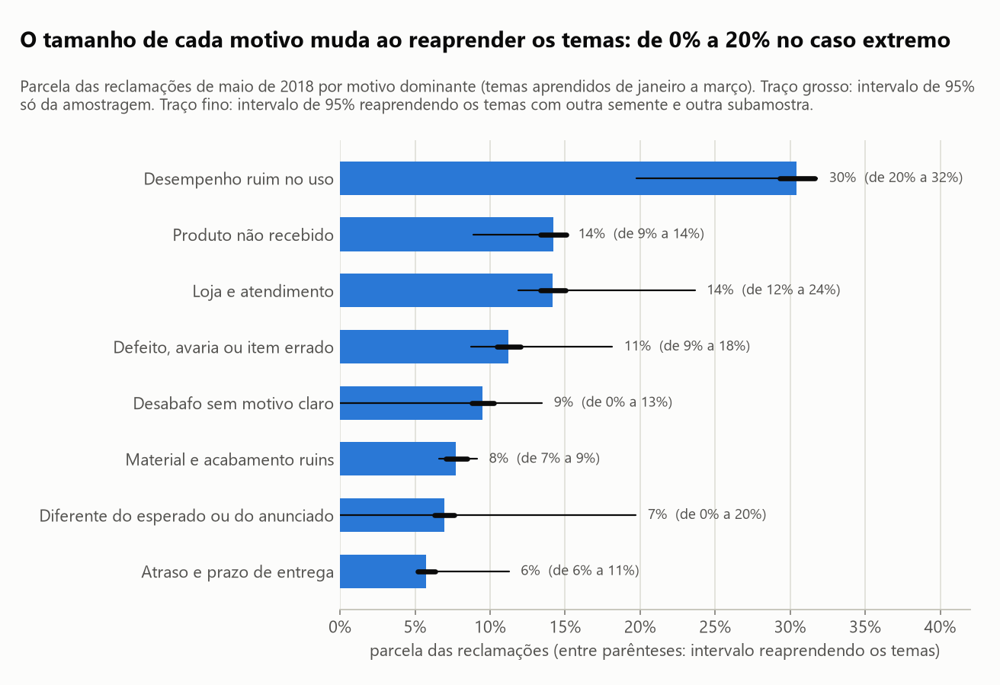
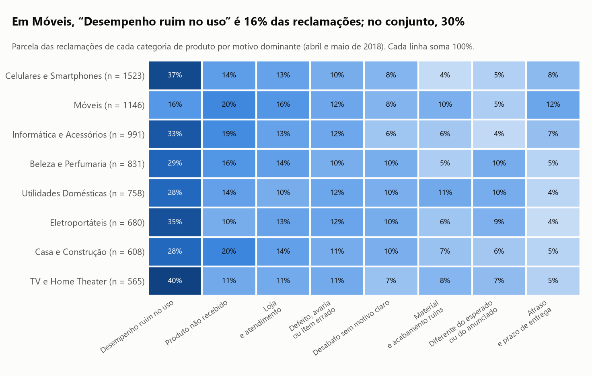

# Do que os clientes reclamam, e dá para confiar numa leitura automática das avaliações?

**Dá para confiar no alerta de insatisfação; na lista de motivos, só como mapa.** Um modelo simples (TF-IDF de
palavras com regressão logística) separa reclamação de elogio com **AUC de 0,963** (intervalo de 95%: 0,960 a
0,965) num mês que ele nunca viu, e 96% do que ele põe nos 10% do topo da pilha é reclamação de fato. Já os
motivos mudam de tamanho quando o modelo de temas é reaprendido: o produto responde por mais da metade das
reclamações e entrega e loja por cerca de um terço, mas dentro disso um motivo pode ir de 0% a 20%.

Base: 126.152 avaliações de produtos em português de um grande e-commerce brasileiro (B2W-Reviews01, janeiro a
maio de 2018). O modelo aprende de janeiro a março, é ajustado em abril e é testado em maio.

## Em 30 segundos

- **O alerta funciona com o método mais simples.** Lendo só os 10% de avaliações de maior escore, o time encontra
  95,8% de reclamações e pega 33,9% de todas elas (o máximo possível, com ordenação perfeita, é 35,4%). Para pegar
  80% das reclamações, precisa ler 25,1% das avaliações (o mínimo possível é 22,6%).
- **A alternativa ingênua quase empata na pilha pequena e perde na grande.** Uma lista de 102 palavras negativas
  escrita à mão, sem treino, já entrega 89,0% de reclamações nos 10% do topo. Mas para pegar 80% delas pede a
  leitura de 32,8% das avaliações. N-gramas de caracteres e a representação densa de um modelo de linguagem
  (MiniLM) não melhoram o TF-IDF de palavras.
- **Se a nota existe, ela é um alerta melhor que o texto.** A regra "nota até 2" acerta 91,3% do que marca; o
  modelo de texto, marcando o mesmo volume, 87,4%. O texto acrescenta pouco à nota (AUC de 0,964 para 0,974) e
  ajuda mais onde a nota é ambígua: dentro da nota 3, a AUC do texto é 0,81.
- **A métrica depende do rótulo.** A nota e o "recomendaria" discordam em 4,4% das avaliações. O mesmo modelo vale
  0,963, 0,980 ou 0,989 de AUC conforme o gabarito. Dos 45 "alarmes falsos" mais confiantes do modelo, 41 eram
  reclamações de verdade, escritas por quem deu nota 4 ou 5.
- **Os motivos são um mapa, não uma medida.** Dez temas viram oito motivos com nome. Entre duas execuções do
  modelo de temas, cerca de 7,6 de cada 10 palavras de um tema se repetem (estabilidade de 0,62); 6 dos 8 motivos
  aparecem em todas as 10 execuções, e o tamanho de cada um muda: "Loja e atendimento" é 14% das reclamações no
  modelo de referência, com intervalo de 12% a 24% quando os temas são reaprendidos.
- **Para a decisão:** ligar o alerta e usar os motivos para saber onde olhar (um terço das reclamações é de
  entrega e loja, não de produto), sem cobrar meta do tipo "reduzir o motivo X em dois pontos".

## As figuras

### 1. Quanto o time pega lendo só uma parte



Se o time lê primeiro as avaliações que o método aponta, quanto das reclamações cai na pilha lida? Perto da
origem as três curvas andam juntas: quando se lê pouco, qualquer método que ache as reclamações óbvias chega
perto do teto. A diferença aparece depois. O léxico só ordena as avaliações em que alguma palavra da lista
aparece (33% delas); daí em diante, lê ao acaso. O modelo segue ordenando.

| Método (teste: maio, 24.309 avaliações) | AUC | Lendo 10%: precisão | Lendo 10%: reclamações pegas | Leitura para pegar 80% |
| --- | --- | --- | --- | --- |
| Léxico de palavras negativas (sem treino) | 0,857 (0,852 a 0,863) | 89,0% (87,8% a 90,2%) | 31,5% (30,8% a 32,1%) | 32,8% (32,3% a 34,0%) |
| **TF-IDF de palavras + regressão logística** | **0,963** (0,960 a 0,965) | **95,8%** (95,0% a 96,7%) | **33,9%** (33,2% a 34,6%) | **25,1%** (24,7% a 25,6%) |
| TF-IDF de caracteres + regressão logística | 0,961 (0,959 a 0,964) | 95,1% (94,3% a 96,0%) | 33,7% (32,9% a 34,4%) | 25,2% (24,8% a 25,8%) |

Rótulo: respondeu "não" a "recomendaria este produto?" (28,3% das avaliações de maio). Intervalos de 95% por
bootstrap. Na comparação pareada, o modelo de palavras supera o léxico em tudo (AUC: +0,105, de 0,101 a 0,110).
Contra o de caracteres, a vantagem é de 0,001 de AUC (0,001 a 0,002): existe, e não muda decisão nenhuma.

### 2. A nota e o "recomendaria" não contam a mesma história



Cada avaliação traz dois sinais de insatisfação: a nota e a resposta a "recomendaria?". Eles discordam em 4,4%
das avaliações (5.611 de 126.152), e a discordância se concentra onde importa:

| Nota | Avaliações | Não recomendaria (IC 95%) |
| --- | --- | --- |
| 1 | 24.579 | 97,1% (96,9% a 97,3%) |
| 2 | 7.983 | 75,3% (74,4% a 76,2%) |
| 3 | 15.773 | 11,3% (10,9% a 11,8%) |
| 4 | 31.612 | 1,5% (1,4% a 1,6%) |
| 5 | 46.205 | 1,4% (1,3% a 1,6%) |

Treinar com um rótulo ou com o outro quase não muda o modelo (AUC de 0,963 e 0,962 contra "não recomendaria").
Trocar o gabarito muda a métrica: 0,963 contra "não recomendaria", 0,980 contra "nota até 2" e 0,989 nas
avaliações em que os dois sinais concordam. Parte do "erro" do modelo é desacordo entre os rótulos.

O que há nesse desacordo? Foram lidos, um a um, os 45 "alarmes falsos" de maior escore (nota 4 ou 5,
"recomendaria", e o modelo diz reclamação) e as 45 "reclamações perdidas" de menor escore. Exemplos, parafraseados:

| O que a pessoa escreveu (paráfrase) | Nota | Recomendaria? | O modelo diz |
| --- | --- | --- | --- |
| "Como vou avaliar um produto que ainda não recebi?" | 5 | sim | reclamação |
| "O aparelho é ótimo. A loja atrasou a entrega e ninguém responde." | 4 | sim | reclamação |
| "Marquei excelente para ver se publicam: as avaliações ruins não apareceram." | 5 | sim | reclamação |
| "É bom, mas a imagem fica um pouco embaçada." | 2 | não | elogio |
| "Ótimo para enfeitar a estante." (ironia) | 1 | não | elogio |

| Leitura manual | Categoria | Avaliações (IC 95%) |
| --- | --- | --- |
| 45 alarmes falsos mais confiantes | reclamação de entrega ou atendimento | 32 (57% a 82%) |
| | reclamação do produto recebido | 9 (11% a 34%) |
| | ironia ou comentário sobre o preço do anúncio | 3 (2% a 18%) |
| | ambíguo | 1 (0% a 12%) |
| 45 reclamações perdidas mais confiantes | elogio e crítica no mesmo texto ("é bom, mas...") | 26 (43% a 71%) |
| | crítica sem palavra típica de reclamação | 9 (11% a 34%) |
| | pergunta ou texto sem relato da compra | 6 (6% a 26%) |
| | ironia ou piada | 4 (4% a 21%) |

Dos 45 alarmes falsos, 41 eram reclamações de verdade: na maior parte, gente que não recebeu o produto e deu nota
alta porque a avaliação era "do produto". O modelo estava certo e o rótulo, errado. No teste inteiro, o modelo lê
como reclamação 187 das 14.123 avaliações de nota 4 ou 5 que recomendariam (1,3%; de 1,1% a 1,5%). Do outro lado,
o que ele deixa passar é o texto morno: elogio e crítica juntos, ou ironia.

### 3. A probabilidade precisa ser recalibrada, e o texto longo é onde mais se erra



A probabilidade que sai do modelo erra, em média, 0,033 (0,030 a 0,036) em relação à frequência observada. A
taxa de reclamação subiu de 25,4% no treino para 28,3% em maio, e o modelo é tímido nas faixas altas. Uma
recalibração de Platt ajustada em abril reduz o erro para 0,021 (0,018 a 0,024). Melhora, mas não zera.

| Recorte do teste | Avaliações | AUC (IC 95%) | Reclamações perdidas | Alarmes falsos |
| --- | --- | --- | --- | --- |
| Texto fala de entrega ou prazo | 9.060 | 0,962 (0,958 a 0,967) | 8% | 7% |
| Texto não fala de entrega | 15.249 | 0,961 (0,958 a 0,965) | 18% | 4% |
| Até 5 palavras | 144 | 0,968 (0,914 a 1,000) | 18% | 2% |
| 6 a 10 palavras | 5.057 | 0,952 (0,939 a 0,963) | 18% | 1% |
| 11 a 20 palavras | 10.271 | 0,963 (0,959 a 0,968) | 15% | 3% |
| 21 a 40 palavras | 5.792 | 0,952 (0,947 a 0,957) | 14% | 8% |
| Mais de 40 palavras | 3.045 | 0,929 (0,920 a 0,937) | 10% | 17% |

Reclamação perdida: reclamação com probabilidade abaixo de 50%. Alarme falso: não reclamação com 50% ou mais.
Reclamação de entrega é a mais fácil de pegar (perde 8%); reclamação do produto em si se perde mais (18%). O
texto longo mistura assuntos e tem a pior AUC. Esta base quase não tem texto curto (144 avaliações com até 5
palavras), então o estudo não diz como o alerta se sai em comentário de rede social. Por gênero, faixa de idade
e região do avaliador, sempre em agregado, a AUC fica entre 0,947 e 0,967.

### 4. Os temas mudam a cada execução



Para os motivos, o NMF sobre TF-IDF foi ajustado nas 16.925 reclamações de janeiro a março com rótulo sem
ambiguidade (nota até 2 e "não recomendaria"). A pergunta de estabilidade: repetindo o ajuste com outra semente
e outra subamostra de 80% das reclamações, os mesmos temas voltam? Em parte. A estabilidade (Jaccard das 10
palavras do topo de cada tema, casando os temas de duas execuções) fica entre 0,57 e 0,70 com 4 a 12 temas e não
aponta um número melhor. O número adotado, 10, foi escolhido por leitura: é o menor número testado em que os oito
motivos aparecem separados. Com 10 temas, a estabilidade é 0,62 (de 0,48 a 0,81 entre os 45 pares de execuções).

| Tema | Palavras de maior peso | Motivo | Estabilidade |
| --- | --- | --- | --- |
| 1 | nao_recebi, hoje, nao_avaliar, mes, agora, momento | Produto não recebido | 0,83 |
| 2 | americanas, compra, site, loja, nem, agora | Loja e atendimento | 0,88 |
| 3 | qualidade, pessima, ruim, material, baixa, nao_recomendo | Material e acabamento ruins | 0,82 |
| 4 | defeito, veio, troca, chegou, quebrado, devolucao | Defeito, avaria ou item errado | 0,65 |
| 5 | entrega, prazo, dias, atraso, demora, dia | Atraso e prazo de entrega | 0,76 |
| 6 | avaliar, nao_posso, posso, nao_entregue, nem, recebi | Produto não recebido | 0,71 |
| 7 | nao_gostei, ruim, nao_recomendo, foto, fraco, achei | Diferente do esperado ou do anunciado | 0,63 |
| 8 | nao_chegou, hoje, mes, dia, comprei, chegar | Produto não recebido | 0,40 |
| 9 | mas, uso, comprei, mesmo, ruim, bem, aparelho | Desempenho ruim no uso | 0,71 |
| 10 | pessimo, nao_recomendo, dinheiro, atendimento, horrivel, ninguem | Desabafo sem motivo claro | 0,56 |

O NMF separa pelo vocabulário, não pelo motivo: "não recebi", "não chegou" e "não posso avaliar" viram três temas
para a mesma reclamação. Por isso os temas recebem o nome de um motivo por uma regra de palavras-âncora, escrita
depois de ler os temas, que junta temas do mesmo motivo e vale para qualquer execução.

A comparação pedida, agrupamento sobre a representação densa, é menos estável. Nas mesmas 8.107 reclamações da
amostra e com o mesmo protocolo:

| Método (10 grupos) | Estabilidade (mínimo a máximo) | Mesmo motivo que o NMF |
| --- | --- | --- |
| NMF sobre TF-IDF | 0,54 (0,39 a 0,72) | referência |
| k-means sobre MiniLM | 0,42 (0,28 a 0,68) | 33% das reclamações |
| k-means sobre LSA | 0,42 (0,36 a 0,47) | 52% das reclamações |

### 5. O tamanho de cada motivo



Parcela das 6.247 reclamações de maio por motivo dominante, com os temas aprendidos de janeiro a março. Dois
intervalos de 95%: o de amostragem mantém os temas fixos e reamostra as reclamações; o de reajuste também
reaprende os temas (10 execuções, cada uma com outra semente e outra subamostra do treino).

| Motivo | Parcela | Intervalo de amostragem | Intervalo de reajuste | Execuções em que aparece |
| --- | --- | --- | --- | --- |
| Desempenho ruim no uso | 30,4% | 29,3% a 31,7% | 19,8% a 31,8% | 10 de 10 |
| Produto não recebido | 14,2% | 13,4% a 15,1% | 8,9% a 14,5% | 10 de 10 |
| Loja e atendimento | 14,2% | 13,3% a 15,0% | 11,9% a 23,6% | 10 de 10 |
| Defeito, avaria ou item errado | 11,2% | 10,5% a 12,0% | 8,8% a 18,1% | 10 de 10 |
| Desabafo sem motivo claro | 9,5% | 8,8% a 10,3% | 0,0% a 13,5% | 8 de 10 |
| Material e acabamento ruins | 7,7% | 7,1% a 8,5% | 6,6% a 9,1% | 10 de 10 |
| Diferente do esperado ou do anunciado | 6,9% | 6,3% a 7,6% | 0,0% a 19,7% | 8 de 10 |
| Atraso e prazo de entrega | 5,7% | 5,2% a 6,3% | 5,7% a 11,3% | 10 de 10 |

O intervalo de amostragem é estreito e engana: ele supõe que os temas são um fato. O de reajuste mostra o que
acontece quando o tema é reaprendido. Só "Material e acabamento ruins" tem o tamanho firme. Somando por família,
o quadro é mais estável: entrega e loja ficam com 34,1% das reclamações no modelo de referência (de 33,4% a 43,1%
entre as execuções) e o produto com 56,4% (de 44,1% a 60,3%).

O método também pesa. Na amostra, "Desempenho ruim no uso" é 33% das reclamações pelo NMF e 15% pelo k-means
sobre MiniLM. Esse tema é o balde do NMF: recebe os relatos longos de uso que não cabem nos outros.

### 6. A mistura de motivos muda com o produto



Nas oito categorias com mais reclamações em abril e maio, o desenho muda. Em Móveis, "Desempenho ruim no uso" é
16% das reclamações, contra 30% no conjunto, e "Produto não recebido" e "Atraso e prazo de entrega" somam quase
um terço: móvel é reclamação de logística. Em TV e Home Theater, 40% das reclamações são de desempenho. Uma
diferença desse tamanho (16% contra 40%) é maior que a incerteza do próprio tema, que no conjunto vai de 20% a 32%
quando reaprendido. Diferenças de poucos pontos entre categorias, não.

## Como foi feito

1. **Dados e limpeza.** Das 132.373 linhas do arquivo, saem 18 sem resposta em "recomendaria", 3.383 de texto
   vazio, 1.180 avaliações repetidas (mesmo avaliador, produto e texto) e 1.640 textos copiados em avaliações
   diferentes (fica a primeira no tempo, para o mesmo texto não cair no treino e no teste). Ficam 126.152.
2. **Separação no tempo.** Treino de janeiro a março (73.183), validação e calibração em abril (28.660), teste em
   maio (24.309). Vocabulário, IDF, pesos, regularização, calibração e temas só veem o que vem antes do teste.
3. **Texto.** Título e corpo juntos, em minúsculas, sem acento e sem pontuação.
4. **TF-IDF implementado em NumPy/SciPy** (`src/nlp_avaliacoes/texto.py`): palavras e pares de palavras (51.108
   termos) e n-gramas de 3 a 5 caracteres (77.585 termos), estes contados com aritmética de vetores. Os testes
   conferem as duas matrizes contra o scikit-learn num corpus mínimo.
5. **Classificador.** Regressão logística do scikit-learn sobre cada representação, com a regularização escolhida
   pela AUC de abril. O modelo de palavras é o principal; ele também teve a maior AUC na validação.
6. **Métricas com incerteza** (`metricas.py`): AUC pelos postos, precisão e revocação lendo uma parcela da pilha
   (com valor esperado nos empates), bootstrap percentil e bootstrap pareado para diferenças. São 1.000
   reamostragens nas tabelas principais, 500 nas análises de apoio e 200 nos recortes da análise de erro.
7. **Ruído de rótulo.** Discordância entre os dois sinais, o mesmo modelo avaliado contra cada gabarito, o texto
   dentro de cada nota, um modelo de segundo estágio (nota mais escore do texto, ajustado em abril) e a leitura
   manual de 90 erros (`data/leitura_manual_de_erros.csv`, só identificador e categoria). As 90 avaliações foram
   escolhidas pelo escore de uma versão preliminar do modelo; no modelo final, 45 dos 45 alarmes falsos e 44 das
   45 reclamações perdidas continuam entre os 45 mais extremos de cada tipo.
8. **Calibração.** Platt ajustado em abril, medido em maio.
9. **Motivos** (`temas.py`): NMF do scikit-learn sobre um TF-IDF de palavras com a negação colada ("nao_recebi"),
   sem termos presentes em mais de 35% das reclamações. A medida de estabilidade (casamento ótimo dos temas de
   duas execuções e Jaccard das palavras do topo) é implementada e testada contra casos de resposta conhecida.
10. **Representação densa.** O modelo `paraphrase-multilingual-MiniLM-L12-v2` (ONNX quantizado, pela biblioteca
    `fastembed`, sem PyTorch) rodou uma vez numa amostra fixa de 20.000 avaliações: 241 MB de modelo, cerca de 20
    minutos com 2 threads e pico de 1,1 GB de memória. O resultado fica em `data/brutos/`, fora do git. A
    comparação treina cada representação nas mesmas 9.000 avaliações e testa nas mesmas 5.000. A análise semântica
    latente (LSA) entra como representação densa que não precisa de modelo de linguagem.

## Comparação com a alternativa simples

No teste completo (maio), contra o rótulo "não recomendaria":

| Método | Lê o texto? | Precisa de treino? | AUC | Precisão nos 10% do topo | Leitura para pegar 80% |
| --- | --- | --- | --- | --- | --- |
| Léxico de 102 palavras negativas | sim | não | 0,857 | 89,0% | 32,8% |
| Só a nota de 1 a 5 | não | não | 0,964 | 96,8% | 24,0% |
| **TF-IDF de palavras + regressão logística** | sim | sim | **0,963** | **95,8%** | **25,1%** |
| TF-IDF de caracteres + regressão logística | sim | sim | 0,961 | 95,1% | 25,2% |
| Nota + texto (segundo estágio) | sim | sim | 0,974 | 98,4% | 23,6% |

A regra "nota até 2" marca 28,1% das avaliações com precisão de 91,3% (90,6% a 92,0%) e revocação de 91,0%
(90,3% a 91,6%). O modelo de texto, marcando o mesmo volume, fica em 87,4% (86,3% a 88,4%) e 87,0% (85,9% a
88,0%). **Com a nota em mãos, o texto sozinho perde para ela.** Ele vale onde não há nota (atendimento, chat,
rede social), para desempatar a nota 3 e para chegar aos motivos. Juntar os dois soma 0,010 de AUC (0,008 a
0,011) à nota sozinha.

Na amostra em que a representação densa foi calculada (treino em 9.000 avaliações, teste em 5.000):

| Representação + regressão logística | AUC (IC 95%) | Diferença para o TF-IDF (IC 95%) |
| --- | --- | --- |
| TF-IDF de palavras | 0,954 (0,946 a 0,961) | referência |
| LSA, 200 dimensões | 0,952 (0,944 a 0,958) | −0,002 (−0,004 a 0,000): empate |
| MiniLM multilíngue, 384 dimensões | 0,946 (0,937 a 0,952) | −0,008 (−0,013 a −0,004): pior, por pouco |
| TF-IDF de palavras treinado na base inteira (73 mil) | 0,959 (0,952 a 0,966) | +0,006 (0,004 a 0,007) |

**O método simples empata ou ganha.** Nesta tarefa, o modelo de linguagem congelado não superou o TF-IDF, e ter
oito vezes mais dados de treino valeu mais do que trocar de representação.

## Onde este estudo falha

- **Nenhum dos dois rótulos é a verdade.** O estudo mede a concordância do modelo com sinais ruidosos. A leitura
  manual tem 90 avaliações, foi feita uma vez, com o assistente de IA e sem segundo avaliador, e olha só os erros
  mais confiantes de uma versão do modelo: é um indício qualitativo, não uma taxa de erro do rótulo.
- **Uma loja, cinco meses de 2018, um mês de teste.** A taxa de reclamação já muda dentro da base (25,4% no
  treino, 28,3% em maio), a calibração sofre com isso e a recalibração corrige só parte (erro de 0,021). Em outra
  loja ou outro ano, o vocabulário e a taxa são outros.
- **Quase não há texto curto.** Só 144 das 24.309 avaliações de maio têm até 5 palavras. O estudo não mede o
  alerta em comentário curto de rede social ou de chat.
- **Texto morno e ironia passam.** Das 45 reclamações perdidas lidas, 26 misturavam elogio e crítica e 4 eram
  ironia. Em texto com mais de 40 palavras, 17% das não reclamações viram alarme falso.
- **Os motivos não têm gabarito.** Os nomes e as palavras-âncora foram escritos depois de ler os temas, e o
  número de temas foi escolhido por leitura. "Desempenho ruim no uso" (30,4%) é um balde. Cada reclamação conta
  só no motivo dominante, mesmo quando fala de dois. "Diferente do esperado" e "Desabafo" somem em 2 das 10
  execuções, e trocar o método de agrupamento muda o tamanho dos motivos.
- **A curva de estabilidade por número de temas é ruidosa:** 5 execuções (10 pares) por número; só o número
  adotado tem 45 pares.
- **A comparação com o modelo de linguagem é limitada.** Um modelo pequeno e multilíngue, congelado, numa amostra
  de 20.000 avaliações, com regressão logística por cima. Um modelo ajustado para a tarefa, ou maior, pode ir
  melhor; isso não foi testado por limite de memória e de tempo.
- **A mesma pessoa pode estar no treino e no teste:** 5,7% das avaliações de maio são de avaliadores que também
  escreveram antes de abril.

## Como rodar

Pré-requisito: [`uv`](https://docs.astral.sh/uv/getting-started/installation/).

```bash
uv sync
uv run python scripts/baixar_dados.py     # baixa o corpus (49 MB) para data/brutos/ e confere o sha256
uv run python scripts/rodar_analise.py    # cerca de 3 minutos; regera reports/resultados.json e as figuras
uv run pytest -q -p no:cacheprovider      # 76 testes
```

A representação densa é opcional e roda uma vez só:

```bash
uv sync --group embeddings
uv run --group embeddings python scripts/gerar_embeddings.py   # cerca de 20 minutos; baixa 241 MB de modelo
```

Sem o arquivo de embeddings, `rodar_analise.py` roda tudo o que não depende dele, usa o LSA como representação
densa e avisa; as linhas do MiniLM deste README não são regeradas. O notebook [`analise.ipynb`](analise.ipynb)
conta a história com as tabelas; para refazê-lo, `uv run python scripts/montar_notebook.py` e depois
`uv run jupyter nbconvert --to notebook --execute --inplace analise.ipynb`.

### Dados, licença e privacidade

O corpus é o **B2W-Reviews01** (B2W Digital / Americanas), publicado em
[github.com/americanas-tech/b2w-reviews01](https://github.com/americanas-tech/b2w-reviews01) e descrito por Real,
que acompanha o repositório de origem. Licença **Creative Commons Atribuição-NãoComercial-CompartilhaIgual 4.0 (CC BY-NC-SA
4.0)**: uso não comercial, com crédito à B2W Digital, e obra derivada sob a mesma licença.

Este repositório não redistribui o corpus nem trechos dele. O arquivo bruto e os embeddings ficam em
`data/brutos/`, fora do git. O que é versionado são o código (licença MIT), os resultados agregados e a leitura
manual, que traz só um identificador embaralhado e a categoria. Os exemplos deste README são paráfrases. Ano de
nascimento, gênero e estado do avaliador entram só em tabelas agregadas.

## Como este estudo foi feito

Este estudo foi construído com assistência de IA (Claude Code, da Anthropic), usada como par de programação.
Declaro a divisão do trabalho porque ela importa para quem avalia:

- **Meu:** a direção (quais frentes da ciência de dados estudar e por quê), o contexto de negócio que dá sentido à
  pergunta, vindo de onze anos de marketing digital (tráfego pago desde 2021, automação desde 2018), a leitura
  crítica dos resultados e a decisão do que publicar e do que declarar como limitação.
- **Com o assistente:** a formulação da pergunta a partir desse contexto, a escolha da base pública e do método, a
  implementação do código, dos testes e dos gráficos, e a redação, que revisei.
- **Como conferir:** todo número deste README sai de `reports/resultados.json`, gerado por
  `scripts/rodar_analise.py`. Os testes em `tests/` conferem as funções de método contra casos de resposta
  conhecida.

É o mesmo jeito que trabalho nos sistemas que entrego: a IA acelera a implementação, e a responsabilidade pelo que
está escrito aqui é minha.

## Summary (English)

Can an automated reading of customer reviews be trusted, and what do customers complain about? Using B2W-Reviews01
(126,152 Portuguese product reviews from a Brazilian e-commerce site, January to May 2018; trained on January to
March, tuned on April, tested on May), a plain TF-IDF plus logistic regression flags dissatisfied customers with an
AUC of 0.963 (95% CI 0.960 to 0.965); reading only the top-scored 10% of reviews, 95.8% of what the team reads is
a complaint. A hand-made list of 102 negative words nearly ties at that small budget (89.0%) and falls behind when
more must be read. Character n-grams and frozen MiniLM embeddings do not beat word TF-IDF, and the star rating,
when available, is a better alert than the text. Label noise matters: the same model scores 0.963, 0.980 or 0.989
depending on which label is the answer key, and 41 of its 45 most confident "false alarms" were real complaints
written under a 4 or 5 star rating. Complaint reasons come from NMF topics named by an anchor-word rule; topic
stability across seeds and subsamples is 0.62, and the share of a reason can swing widely when topics are
re-learned, so the reasons work as a map rather than a measurement. TF-IDF (word and vectorized character
n-grams), the metrics with bootstrap intervals and the topic stability measure are implemented in NumPy/SciPy and
tested against known answers. Code and notebook are in Portuguese.
